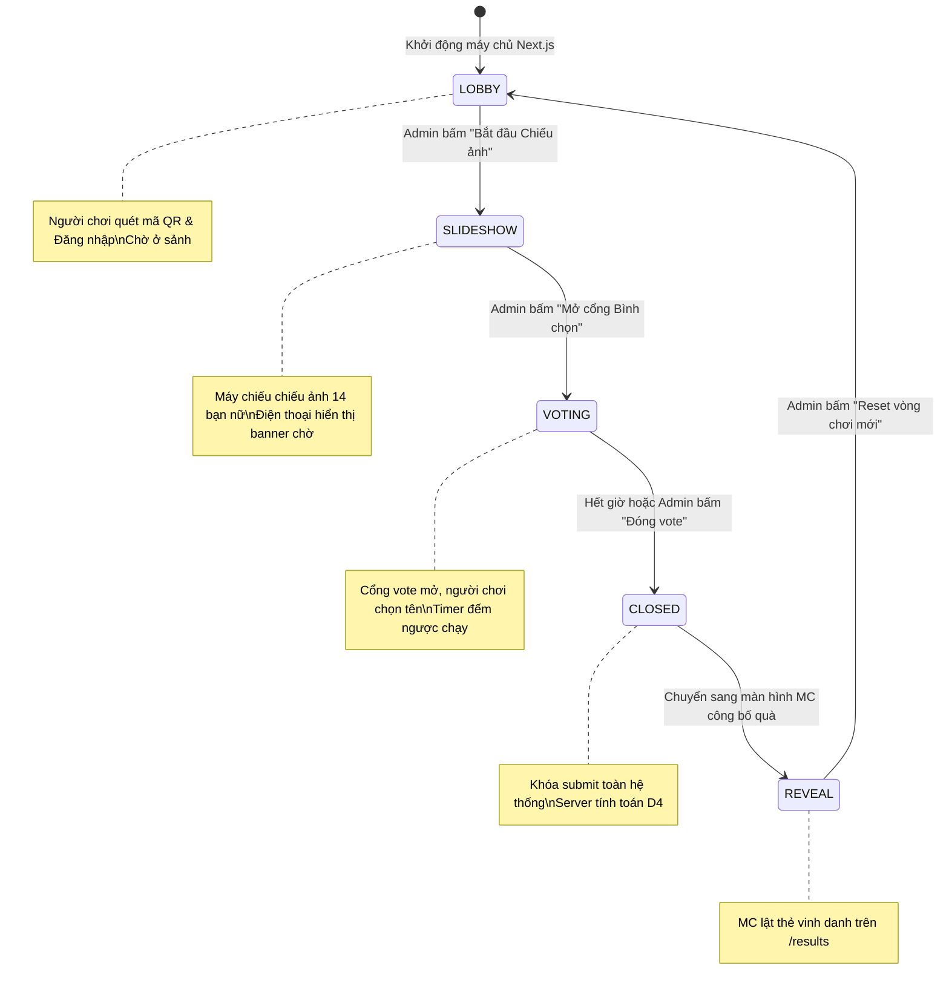

# Admin Operations Skill

## 1. Mục Đích
Skill này chuẩn hóa toàn bộ nghiệp vụ kiểm soát và điều phối phòng game từ Bảng điều khiển Quản trị (`/admin`):
- **Game State Transition Pipeline**: Kiểm soát 5 pha trạng thái sự kiện (`LOBBY` $\rightarrow$ `SLIDESHOW` $\rightarrow$ `VOTING` $\rightarrow$ `CLOSED` $\rightarrow$ `REVEAL`).
- **Live Question Broadcaster**: Điều khiển chiếu và kích hoạt nhận câu trả lời cho từng câu hỏi từ 1 đến 14, tùy chỉnh thời gian đếm ngược (15s, 20s, 30s, 45s).
- **Live Roster Monitor**: Giám sát thời gian thực tiến độ nộp bài của 30-40 người chơi nam (phân loại Đã nộp / Đang làm / Chưa vào phòng).
- **Wi-Fi LAN QR Modal**: Hiển thị địa chỉ IP máy chủ và mã QR trực quan cho người chơi quét điện thoại vào phòng.
- **Khôi phục & Reset an toàn (Emergency Session Reset)**: Xóa sạch dữ liệu bình chọn thử nghiệm mà không làm mất danh sách người dùng và dữ liệu gốc 14 bạn nữ.

---

## 2. Cấu Trúc Module
- `src/app/admin/page.tsx`: Giao diện Dashboard Admin tổng hợp toàn bộ các control cards.
- `src/app/api/admin/state/route.ts`: API thay đổi trạng thái phòng game và thời gian đếm ngược.
- `src/app/api/admin/roster/route.ts`: API lấy danh sách người chơi và tiến độ nộp bài thời gian thực.
- `src/app/api/admin/network/route.ts`: API lấy thông tin IP LAN nội bộ máy tính host.
- `src/app/api/admin/reset/route.ts`: API xóa phiếu bầu và đưa hệ thống về trạng thái ban đầu.

---

## 3. Quản Trị Vòng Đời Phòng Game (Game State Lifecycle)



---

## 4. Đặc Tả Các Khối Chức Năng Trên `/admin`

### 4.1. Khối Điều Khiển Trực Tiếp (Live Question & Timer Control)
- **Chọn câu hỏi active (`currentQuestionNumber`)**: Cho phép chọn câu từ 1 đến 14.
- **Trạng thái nhận bài (`isQuestionActive`)**: Bật / Tắt nhận câu trả lời từ người chơi.
- **Bộ đếm thời gian (`timerDurationSec`)**: Các mức cố định (15s, 20s, 30s, 45s).
- **Kích hoạt đếm ngược**: Ghi nhận `timerStartedAt = new Date()` vào bảng `GameState`. Điện thoại người chơi và máy chiếu tự động đếm ngược đồng bộ.

### 4.2. Khối Giám Sát Người Chơi (Live Roster Monitor)
- **Thống kê tổng quan (Metrics Counter)**:
  - Tổng số người chơi đăng ký (VD: 36 nam).
  - Đã nộp hoàn tất (`14/14 câu`).
  - Đang làm dở (`1 - 13 câu`).
  - Chưa đăng nhập / Chưa nộp câu nào (`0 câu`).
- **Bộ lọc danh sách (Filter Tabs)**: `Tất cả` | `Đã hoàn thành` | `Đang làm` | `Chưa vào`.
- **Chi tiết từng người chơi**:
  - Tên đầy đủ, tên đăng nhập.
  - Số câu đã trả lời / 14 câu.
  - Mốc thời gian hoàn thành câu gần nhất (`HH:mm:ss`).

### 4.3. Modal Mã QR Mạng Wi-Fi (LAN Quick Join Modal)
Sử dụng thư viện `qrcode.react` để hiển thị mã QR cỡ lớn trên màn hình Admin / Máy chiếu:
```tsx
import { QRCodeSVG } from 'qrcode.react';

export function LanQrModal({ joinUrl, ip }: { joinUrl: string; ip: string }) {
  return (
    <div className="bg-white p-6 rounded-3xl shadow-2xl text-center border border-slate-200">
      <h3 className="text-xl font-bold text-slate-900 mb-2">Quét mã QR để vào phòng</h3>
      <p className="text-sm text-slate-500 mb-4">Wi-Fi LAN: <span className="font-mono font-bold text-[#DC2626]">{ip}:3000</span></p>
      <div className="p-4 bg-white rounded-2xl shadow-inner inline-block border border-slate-100">
        <QRCodeSVG value={joinUrl} size={240} level="H" />
      </div>
      <p className="mt-4 text-xs text-slate-400 font-mono select-all">{joinUrl}</p>
    </div>
  );
}
```

### 4.4. Reset Phiên Chơi Thử Nghiệm An Toàn (`/api/admin/reset`)
Được bọc trong một Prisma Transaction để đảm bảo tính toàn vẹn:
```typescript
await prisma.$transaction([
  // Xóa toàn bộ phiếu bầu của người chơi
  prisma.vote.deleteMany(),
  // Xóa toàn bộ kết quả vòng đã lưu
  prisma.roundResult.deleteMany(),
  // Đưa GameState về mặc định
  prisma.gameState.update({
    where: { id: 'default' },
    data: {
      status: 'LOBBY',
      currentQuestionNumber: 1,
      isQuestionActive: false,
      timerStartedAt: null,
      currentSlideIndex: 0,
      activeRevealRound: 0,
    },
  }),
]);
```
> [!CAUTION]
> Thao tác Reset KHÔNG BAO GIỜ xóa bảng `User` (tài khoản nam) và bảng `FemaleProfile` (14 bạn nữ).

---

## 5. Kịch Bản Vận Hành Thực Tế Cho Ban Tổ Chức (Run of Show)
1. **Trước giờ G - 30 phút**:
   - Khởi động app: `yarn dev`.
   - Admin vào `/admin`, mở modal QR code để kiểm tra IP hiển thị đúng card mạng Wi-Fi.
   - Chiếu QR lên máy chiếu để khách đến có thể quét và đăng nhập trước.
2. **Trước giờ G - 5 phút**:
   - Kiểm tra Roster: Xác nhận 100% người chơi có mặt đã xuất hiện trong danh sách.
   - Thử nghiệm 1 câu test (nếu cần), sau đó bấm **"Reset dữ liệu chơi thử"**.
3. **Trong lúc chơi**:
   - Admin bấm chọn Câu 1 $\rightarrow$ Bấm "Bắt đầu đếm ngược (20s)".
   - Màn hình Roster sẽ hiển thị số lượng submit tăng dần theo thời gian thực.
   - Khi hoàn thành 14 câu $\rightarrow$ Admin bấm **"CHUYỂN SANG MÀN HÌNH CÔNG BỐ"** (`/results`).
