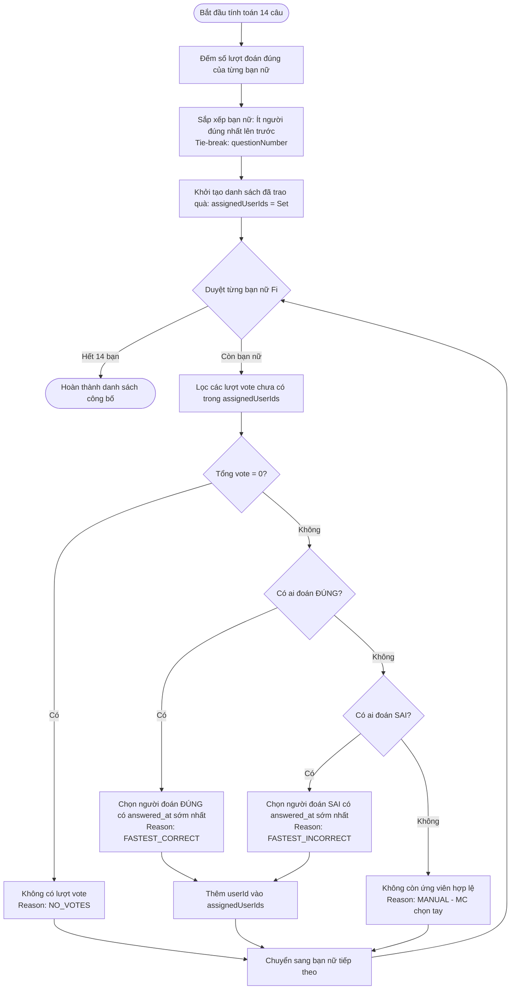

# Game Engine Skill

## 1. Mục Đích
Skill này quản lý toàn bộ nghiệp vụ cốt lõi của trò chơi mini-game sự kiện Astar 20/10:
- **Thuật toán D4 (Gift Presenter Selection Engine)**: Tính toán thứ tự công bố 14 bạn nữ và lựa chọn người chơi nam xứng đáng nhất lên trao quà theo thứ tự ưu tiên nghiêm ngặt và công bằng.
- **Game State Machine**: Điều khiển vòng đời trạng thái phòng game (`LOBBY` $\rightarrow$ `SLIDESHOW` $\rightarrow$ `VOTING` $\rightarrow$ `CLOSED` $\rightarrow$ `REVEAL`).
- **Dynamic Candidate Elimination (Cơ chế loại trừ 1 chiều)**: Tên bạn nữ đã được người chơi chọn ở các câu trước sẽ tự động biến mất khỏi danh sách gợi ý của các câu tiếp theo trên thiết bị di động.

---

## 2. Cấu Trúc Module
- `src/lib/game-engine.ts`: Core pure functions tính toán kết quả D4, phân bổ người trao quà, phân loại lý do và sắp xếp kết quả.
- `src/lib/game-engine.test.ts`: Bộ kiểm thử đơn vị với 100% case bao phủ các trường hợp biên (5/5 tests passing).
- `src/app/api/game/state/route.ts`: API smart polling trạng thái và live timer.
- `src/app/api/vote/progress/route.ts`: API lấy tiến trình làm bài và danh sách tên bạn nữ còn lại chưa được chọn.
- `src/app/api/vote/submit/route.ts`: API ghi nhận phiếu bầu kèm mốc thời gian server chính xác.

---

## 3. Quy Trình Thuật Toán Trao Quà (Epic D4)



---

## 4. Đặc Tả Dữ Liệu & Types

```typescript
export type SelectionReason = 'FASTEST_CORRECT' | 'FASTEST_INCORRECT' | 'MANUAL' | 'NO_VOTES';

export interface FemaleProfileInput {
  id: string;
  name: string;
  orderIndex: number;
  avatarUrl?: string | null;
  hint?: string | null;
}

export interface QuestionInput {
  id: string;
  questionNumber: number;
  femaleProfileId: string;
  photoUrl: string;
}

export interface VoteInput {
  id: string;
  userId: string;
  questionId: string;
  selectedName: string;
  isCorrect: boolean;
  answeredAt: Date | string;
}

export interface UserInput {
  id: string;
  username: string;
  fullName: string;
}

export interface RevealRoundResult {
  femaleProfileId: string;
  femaleName: string;
  orderIndex: number;
  questionId: string;
  questionNumber: number;
  photoUrl: string;
  femaleHint?: string | null;
  totalCorrectGuesses: number;
  totalGuesses: number;
  assignedUserId: string | null;
  assignedUserName: string | null;
  selectionReason: SelectionReason;
  answeredAt: Date | null;
  allVotes: Array<{
    userId: string;
    userName: string;
    selectedName: string;
    isCorrect: boolean;
    answeredAt: Date;
    wasPreviouslyAssigned: boolean;
  }>;
}
```

---

## 5. Hướng Dẫn Sử Dụng Trong Code

### 5.1. Tính toán toàn bộ 14 vòng công bố
```typescript
import { calculateRevealRounds } from '@/src/lib/game-engine';
import { prisma } from '@/src/lib/prisma';

export async function generateGameResults() {
  const [females, questions, votes, users, pastResults] = await Promise.all([
    prisma.femaleProfile.findMany({ orderBy: { orderIndex: 'asc' } }),
    prisma.question.findMany({ orderBy: { questionNumber: 'asc' } }),
    prisma.vote.findMany(),
    prisma.user.findMany({ where: { role: 'PLAYER' } }),
    prisma.roundResult.findMany({ where: { assignedUserId: { not: null } } }),
  ]);

  const alreadyAssignedIds = pastResults.map((r) => r.assignedUserId!).filter(Boolean);

  const results = calculateRevealRounds({
    femaleProfiles: females,
    questions,
    votes,
    users,
    initialAssignedUserIds: alreadyAssignedIds,
    sortBy: 'DIFFICULTY', // Hoặc 'QUESTION_NUMBER'
  });

  return results;
}
```

### 5.2. Lọc danh sách ứng viên còn lại cho người chơi (/vote)
```typescript
export function getRemainingFemaleNames(allFemales: string[], userSelectedNames: string[]): string[] {
  const selectedSet = new Set(userSelectedNames);
  return allFemales.filter((name) => !selectedSet.has(name));
}
```

---

## 6. Xử Lý Các Trường Hợp Biên (Edge Cases)
1. **Người trả lời đúng nhanh nhất đã nhận quà ở câu trước**: Tự động loại trừ và trao quà cho người đoán đúng nhanh kế tiếp.
2. **Cả phòng không ai đoán đúng**: Trao cho người đoán sai nhanh nhất của câu đó (tính chất may mắn/an ủi).
3. **Mọi người tham gia đều đã nhận quà**: Gán `assignedUserId = null` và lý do `MANUAL` để MC chỉ định tay trên sân khấu.
4. **Không có bất kỳ lượt vote nào (`totalCount === 0`)**: Gán lý do `NO_VOTES` và `assignedUserId = null`.
5. **Chống mất tiến trình khi reload**: Lưu kết quả từng vòng đã công bố vào bảng `RoundResult` trong SQLite, cho phép MC tải lại trang bất kỳ lúc nào mà không bị xáo trộn kết quả.
