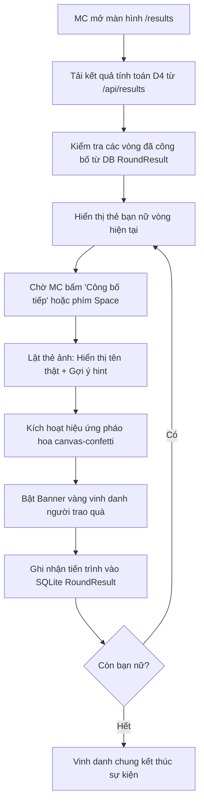

# Presentation Engine Skill

## 1. Mục Đích
Skill này chuẩn hóa toàn bộ các hoạt động hiển thị và tương tác trên màn hình máy chiếu / màn hình lớn (1080p / 4K Projector) của sự kiện Astar 20/10:
- **Màn hình Trình chiếu Live (`/slideshow`)**: Chiếu tự động hoặc theo điều khiển của Admin 14 ảnh chân dung, đồng bộ đồng hồ đếm ngược (Live Timer Countdown), và hỗ trợ phím tắt toàn màn hình.
- **Màn hình Sân khấu Công bố MC (`/results`)**: Trình diễn 14 vòng mở thưởng kịch tính, lật thẻ kết quả (Flip Card), vinh danh người trao quà theo thuật toán D4 (Golden Winner Card), và kích hoạt hiệu ứng pháo hoa ăn mừng `canvas-confetti`.

---

## 2. Cấu Trúc File & Module
- `src/app/(presentation)/slideshow/page.tsx`: Màn hình máy chiếu chiếu slide 14 bạn nữ, lắng nghe trạng thái từ Admin.
- `src/app/(presentation)/results/page.tsx`: Sân khấu công bố kết quả của MC, điều khiển qua phím tắt hoặc nút bấm.
- `src/app/api/results/route.ts`: API tính toán hoặc lấy dữ liệu 14 vòng reveal đã lưu.

---

## 3. Đặc Tả Màn Hình Trình Chiếu (`/slideshow`)

### 3.1. Tính năng cốt lõi
1. **Đồng bộ hóa trực tiếp (Live Slide Sync)**:
   - Polling trạng thái phòng game từ `/api/game/state` mỗi 1 giây.
   - Khi Admin chuyển câu hỏi trên `/admin`, màn hình máy chiếu tự động chuyển ngay lập tức sang ảnh của câu tương ứng.
2. **Đồng hồ đếm ngược trực tiếp (Live Countdown Gauge)**:
   - Tính toán thời gian còn lại dựa trên `timerStartedAt` và `timerDurationSec` do server cung cấp:
     ```typescript
     const elapsedSec = Math.floor((Date.now() - new Date(timerStartedAt).getTime()) / 1000);
     const remainingSec = Math.max(0, timerDurationSec - elapsedSec);
     ```
3. **Phím tắt điều khiển (Keyboard Shortcuts)**:
   - `F`: Bật/Tắt chế độ Toàn màn hình (Fullscreen API).
   - `H`: Ẩn/Hiện thanh công cụ hỗ trợ ở góc dưới.
   - `Mũi tên Trái / Phải` hoặc `A / D`: Chuyển slide thủ công khi offline.
   - `Space`: Tạm dừng / Tiếp tục đếm ngược.

### 3.2. Code mẫu Fullscreen & Keyboard Hook
```typescript
useEffect(() => {
  const handleKeyDown = (e: KeyboardEvent) => {
    if (e.key.toLowerCase() === 'f') {
      if (!document.fullscreenElement) {
        document.documentElement.requestFullscreen().catch(() => {});
      } else {
        document.exitFullscreen().catch(() => {});
      }
    }
  };
  window.addEventListener('keydown', handleKeyDown);
  return () => window.removeEventListener('keydown', handleKeyDown);
}, []);
```

---

## 4. Đặc Tả Màn Hình Công Bố MC (`/results`)

### 4.1. Quy trình mở thưởng 14 Vòng (Reveal Pipeline)


### 4.2. Hiệu ứng Pháo hoa Hạt Đa Tầng (`canvas-confetti`)
Khi lật thẻ bạn nữ và công bố người trao quà, kích hoạt 2 loạt pháo hoa hai bên màn hình với gam màu Crimson & Gold:
```typescript
import confetti from 'canvas-confetti';

export function triggerWinnerConfetti() {
  const colors = ['#DC2626', '#F59E0B', '#EF4444', '#FBBF24', '#FFFFFF'];

  // Bắn từ góc trái
  confetti({
    particleCount: 60,
    angle: 60,
    spread: 70,
    origin: { x: 0.1, y: 0.75 },
    colors,
  });

  // Bắn từ góc phải
  confetti({
    particleCount: 60,
    angle: 120,
    spread: 70,
    origin: { x: 0.9, y: 0.75 },
    colors,
  });
}
```

### 4.3. Thẻ Vinh Danh Người Trao Quà (Golden Winner Card)
Màu sắc chủ đạo Golden Amber (`#F59E0B`, `#A06500`) nổi bật trên nền tối khán phòng:
```tsx
<div className="w-full max-w-xl mx-auto bg-gradient-to-r from-amber-500/20 via-amber-500/10 to-amber-500/20 border-2 border-amber-500/40 rounded-3xl p-6 backdrop-blur-md shadow-[0_0_50px_rgba(245,158,11,0.25)] flex items-center gap-5 animate-in fade-in zoom-in-95 duration-500">
  <div className="w-16 h-16 rounded-2xl bg-amber-500 text-white flex items-center justify-center text-3xl shadow-lg shrink-0">
    🎁
  </div>
  <div className="flex-1 min-w-0">
    <span className="text-xs font-bold tracking-wider uppercase text-amber-400">
      Người trao quà vinh dự
    </span>
    <h3 className="text-2xl font-black text-white truncate">
      {round.assignedUserName || 'Chỉ định thủ công'}
    </h3>
    <p className="text-sm text-slate-300">
      {round.selectionReason === 'FASTEST_CORRECT' && '🎯 Đoán đúng sớm nhất'}
      {round.selectionReason === 'FASTEST_INCORRECT' && '⚡ Đoán sai sớm nhất (May mắn)'}
      {round.selectionReason === 'MANUAL' && '🎤 MC mời ngẫu nhiên từ khán phòng'}
      {round.selectionReason === 'NO_VOTES' && '⚠️ Chưa có lượt bình chọn'}
    </p>
  </div>
</div>
```

---

## 5. Quy Chuẩn Kỹ Thuật Khi Trình Chiếu Máy Chiếu
1. **Tỷ lệ hiển thị (Aspect Ratio)**: Thiết kế cố định tỷ lệ `16:9`, tự co giãn tối ưu cho độ phân giải Full HD (1920x1080) và 4K (3840x2160).
2. **Khả năng chống chói (High Contrast Dark Theme)**: Nền tối (`#0F1218` hoặc `#1F242D`) giúp ảnh chân dung và chữ trắng nổi bật rõ ràng ngay cả khi hội trường bật đèn sáng.
3. **Phục hồi phiên khi reload (Crash Resistance)**:
   - Kết quả từng vòng sau khi lật được lưu ngay vào bảng `RoundResult` trong SQLite.
   - Khi reload trình duyệt (`F5`), hệ thống giữ nguyên vòng đang mở, không bị nhảy lại từ đầu.
