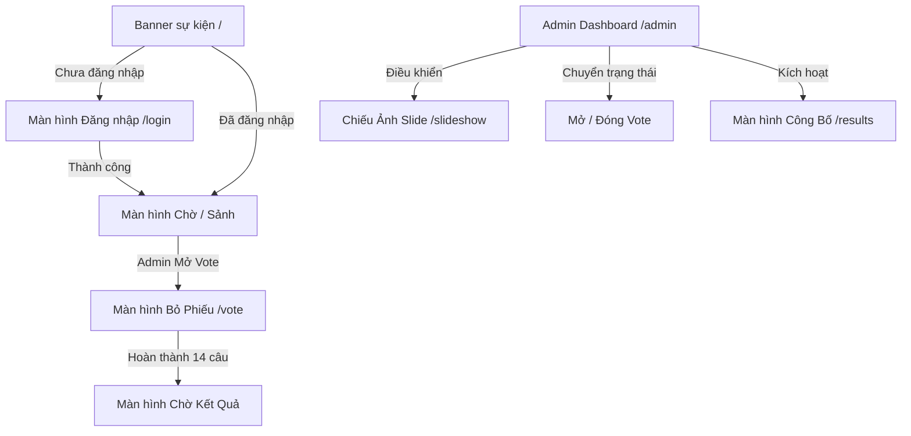

# Astar 20/10 – Đặc Tả Sản Phẩm & Nghiệp Vụ (Product Spec)

## 1. Mục tiêu và Bối cảnh
Ứng dụng tương tác mini-game nội bộ dành cho sự kiện 20/10 tại công ty Astar:
- **14 bạn nữ** tương ứng với 14 bức ảnh (ẩn danh / thử thách) cần đoán tên.
- **Người chơi (Nam)** đăng nhập bằng tên và ngày sinh (DD/MM hoặc format thống nhất), thực hiện dự đoán lần lượt 14 câu hỏi.
- **Quy tắc chọn độc nhất**: Mỗi khi chọn 1 tên cho 1 ảnh, tên đó lập tức bị loại khỏi danh sách các câu tiếp theo.
- **Tiến độ real-time & phục hồi**: Tiến độ lưu trên SQLite Server (laptop admin). Mất mạng hoặc refresh quay lại đúng câu đang làm.
- **Công bố kết quả sôi động**: Màn hình chiếu lớn (MC / Khán giả), công bố từ bạn nữ có ít người đoán đúng nhất, trao quyền tặng quà cho người nhanh nhất và loại trừ dần người đã trúng giải.

---

## 2. Danh Sách Màn Hình & Luồng Người Dùng

### 2.0. Banner sự kiện (`/`)
- Tấm poster toàn màn hình cho khách chưa có phiên: ảnh chúc mừng Ngày Phụ nữ Việt Nam 20/10, nút **Vào sự kiện** dẫn tới `/login`.
- Người chơi đã đăng nhập vào thẳng `/vote`. Admin vào thẳng `/admin`.

### 2.1. Màn hình Đăng nhập (`/login`)
- Người chơi nhập Tên và Ngày sinh (Mật khẩu được seed từ trước).
- Session lưu qua HttpOnly cookie / localStorage token an toàn.
- Chuyển hướng tự động vào `/vote` nếu phiên hợp lệ.

### 2.2. Màn hình Chiếu ảnh (`/slideshow`)
- Dành cho máy chiếu / màn hình lớn.
- Đồng bộ theo câu hỏi mà Admin đang chọn (1 $\rightarrow$ 14).
- Hiển thị đồng hồ đếm ngược trực tiếp (Live Countdown Timer) theo nhịp điều khiển của Admin.

### 2.3. Màn hình Bỏ phiếu (`/vote`)
- **Giao diện mobile-first**: Tối ưu hiển thị ảnh câu hỏi hiện tại, danh sách tên lựa chọn nhanh.
- **Đồng bộ thời gian thực theo Admin (Live Quiz Show)**: Điện thoại người chơi tự động chuyển sang câu hỏi mà Admin đang mở trên máy chiếu.
- **Đồng hồ đếm ngược thời gian thực**: Nhận mốc đếm ngược (15s, 20s, 30s, 45s) từ server và tự động khóa khi hết giờ.
- **Loại trừ đáp án đã chọn**: Danh sách tên chỉ hiển thị những bạn nữ chưa từng được người chơi chọn ở các câu trước đó.
- **Chế độ bảo vệ & phục hồi**: Khi Admin chưa mở câu hỏi hoặc đã khóa, hiển thị banner chờ hiệu lệnh tiếp theo. Hỗ trợ phục hồi vị trí câu và token qua localStorage & URL param.

### 2.4. Màn hình Công bố Kết quả (`/results`)
- Hiển thị trên máy chiếu với hiệu ứng âm thanh/hình ảnh, lật thẻ, pháo hoa (confetti).
- Thứ tự công bố: Từ bạn nữ có ít người đoán đúng nhất -> nhiều nhất.
- Mỗi vòng công bố:
  - Tên & ảnh bạn nữ.
  - Thống kê tỷ lệ đoán đúng/sai.
  - Danh sách người chơi và đáp án họ chọn.
  - **Highlight người trao quà** theo thuật toán D4 (nhanh nhất trong số người chưa nhận quà).
  - Nút MC bấm "Công bố bạn tiếp theo" và hỗ trợ gán thủ công nếu cần.

### 2.5. Màn hình Quản trị (`/admin`)
- **Chủ phòng điều khiển (Slide Master)**: Điều khiển chuyển lần lượt từ Câu 1 $\rightarrow$ 14, tùy chọn thời lượng đếm ngược (15s, 20s, 30s, 45s), bấm "Bắt đầu đếm ngược" và "Khóa câu trả lời".
- **Quản lý trạng thái trò chơi**: Chuyển đổi trạng thái linh hoạt (LOBBY $\rightarrow$ VOTING $\rightarrow$ CLOSED $\rightarrow$ REVEAL).
- **Giám sát trực tiếp (Live Roster)**: Theo dõi tiến độ thời gian thực (ai đã nộp câu hiện tại, ai chưa nộp, danh sách đáp án).
- **Reset game dữ liệu chơi thử**: Đặt lại toàn bộ dữ liệu phiếu bầu và kết quả để bắt đầu lượt chơi chính thức.
- **Mã QR & IP mạng LAN**: Tự động nhận diện IP Wi-Fi nội bộ, hiển thị URL và mã QR để người chơi quét kết nối tức thì.

---

## 3. Thuật Toán Trao Quà (Epic D4)

Với mỗi bạn nữ $F_i$ (theo thứ tự số lượt đoán đúng tăng dần):
1. **Ưu tiên 1**: Trong tập hợp người chơi **chưa được nhận/trao quà**, chọn người có đáp án **ĐÚNG** câu $F_i$ với `answered_at` sớm nhất.
2. **Ưu tiên 2**: Nếu không ai đoán đúng (hoặc tất cả người đoán đúng đã nhận quà ở các vòng trước), chọn người có đáp án **SAI** câu $F_i$ với `answered_at` sớm nhất trong số người chưa nhận quà.
3. **Ưu tiên 3 (Fallback)**: Nếu toàn bộ người chơi đã được trao quà hết (số nam < 14), hệ thống gắn cờ để MC tự chọn thủ công.
4. Người được chọn tại vòng này sẽ bị loại (`assigned = true`) khỏi danh sách xét duyệt của các bạn nữ tiếp theo.
