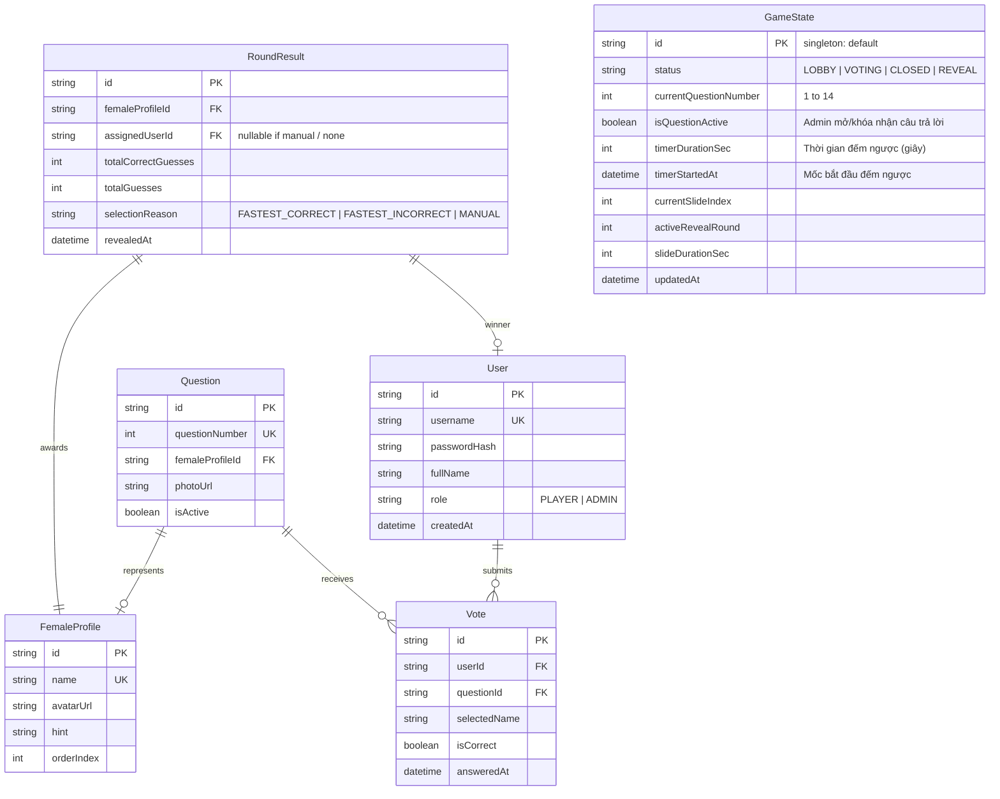

# Astar 20/10 – Mô Hình Dữ Liệu & SQLite Schema

## 1. Sơ đồ Quan Hệ Thực Thể (ERD)

## 2. Ràng Buộc Cơ Sở Dữ Liệu (Constraints & Indexes)
1. **Unique Index `(userId, selectedName)`**: Ngăn người chơi chọn 1 tên 2 lần trong 1 phiên.
2. **Unique Index `(userId, questionId)`**: Ngăn người chơi trả lời 2 lần cho cùng 1 câu hỏi.
3. **Index `(questionId, isCorrect, answeredAt ASC)`**: Tối ưu hóa truy vấn người đoán đúng/sai nhanh nhất cho từng câu.
