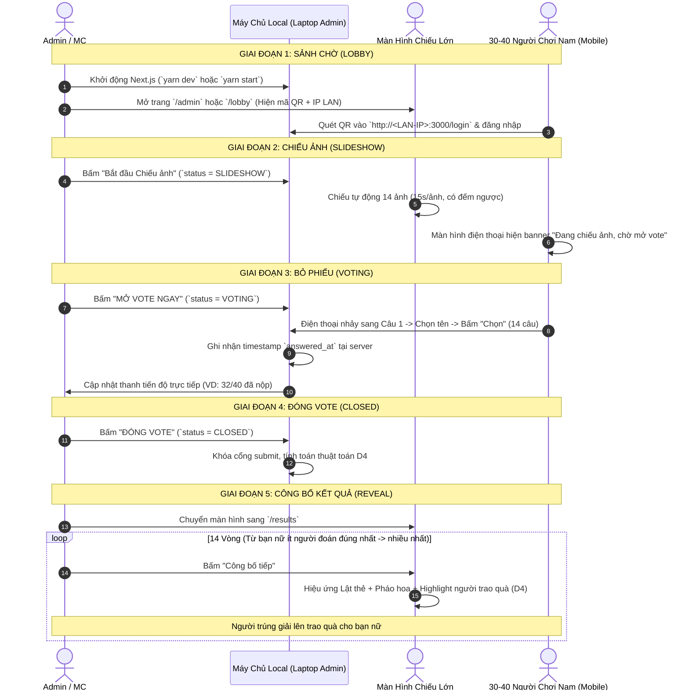

# Workflow 02: Vận Hành Vòng Game Thực Tế (Game Operation Flow)

## 1. Kịch Bản Vận Hành 5 Giai Đoạn

---

## 2. Thao Tác Chi Tiết Cho Từng Vai Trò

### 2.1. Đối với MC / Admin
1. **Kiểm tra trước giờ G:**
   - Laptop kết nối Wi-Fi công ty, cắm dây HDMI lên máy chiếu.
   - Bật app, kiểm tra mã QR kết nối hiển thị đúng IP Wi-Fi nội bộ.
2. **Trong lúc chơi:**
   - Quan sát bảng *"Tiến độ người chơi"* trên màn hình `/admin`.
   - Nhắc nhở những ai đang ở trạng thái *"Đang làm"* hoặc *"Chưa vào"*.
3. **Khi công bố kết quả (`/results`):**
   - Bấm phím cách (Space) hoặc click nút *"Công bố tiếp"* để lật mở từng bạn nữ.
   - Nếu xảy ra tình huống đặc biệt (người trao quà vắng mặt / hết người), MC có thể chỉ định người thay thế thủ công.

### 2.2. Đối với Người Chơi Nam (Mobile)
1. Quét mã QR trên màn chiếu để vào trang đăng nhập.
2. Nhập họ tên và ngày sinh (4 chữ số `DDMM`).
3. Khi cổng vote mở: Xem ảnh, chọn 1 tên duy nhất trong danh sách $\rightarrow$ bấm *"Chọn"*.
4. Sau khi hoàn thành câu 14: Xem màn hình xác nhận *"Đã hoàn tất, hãy hướng mắt về sân khấu"*.

---

## 3. Kế Hoạch Ứng Phó Sự Cố (Contingency Plan)

| Sự cố | Cách khắc phục ngay lập tức |
| :--- | :--- |
| **Người chơi bị mất mạng Wi-Fi hoặc lỡ tắt trình duyệt** | Mở lại trình duyệt $\rightarrow$ Hệ thống tự động phục hồi đúng câu đang làm dở (Tiến độ lưu tại Server SQLite). |
| **Máy chiếu bị lỏng dây hoặc reload trang `/results`** | Kết quả các vòng đã mở được lưu trong SQLite (`RoundResult`), trang sẽ load lại đúng vòng hiện tại mà không bị nhảy lùi. |
| **Muốn tổ chức chơi thử nghiệm trước buổi tiệc** | Admin bấm nút *"Reset game"* trên bảng điều khiển để xóa sạch dữ liệu vote thử và đưa phòng về trạng thái ban đầu. |
